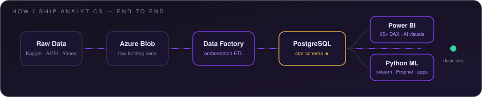
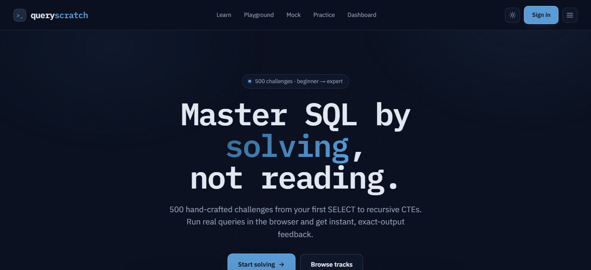

<div align="center">



<br/><br/>


<a href="https://www.linkedin.com/in/sumit-k-prajapat/"></a>
&nbsp;<a href="mailto:sumitkprajapat29@gmail.com"></a>
&nbsp;<a href="https://skpkush.github.io/Sumitkprajapat/"></a>

</div>

<br/>

```sql
sumit_prajapat=# SELECT * FROM about WHERE honest = true;
```

I take data the whole way: **ingestion → Azure pipelines → SQL star schemas → Power BI dashboards → ML models** — and I lead every dashboard with **one quantified headline**, not a wall of charts.

**2+ years inside BFSI** selling and servicing insurance products *before* analyzing them — now a freelance Data Analyst with **Finonus Capital**. B.Com graduate, **Microsoft (PL-300 · AZ-900 · DP-900) and AWS certified**.

> `-- The kind of analyst who measures e-commerce retention on customer_unique_id — the real person —`
> `-- and flags a dataset cut-off artifact before anyone misreads it as a downturn.`
> `-- and says "the data can't prove this campaign worked" when a placebo test fails.`

**Domains** <kbd>Retail & FMCG</kbd> <kbd>Finance & Insurance</kbd> <kbd>Healthcare</kbd> <kbd>E-Commerce</kbd> &nbsp;·&nbsp; **Seeking** <kbd>Data Analyst</kbd> <kbd>BI Developer</kbd> <kbd>Power BI Developer</kbd>


```sql
sumit_prajapat=# EXPLAIN ANALYZE how_i_ship;
```

<div align="center">

</div>


```sql
sumit_prajapat=# SELECT project, headline_metric
sumit_prajapat-# FROM   featured_work
sumit_prajapat-# ORDER  BY impact DESC;
```

| `#`  | `project`                             | `headline_metric`                                  |
| :--- | :------------------------------------ | :------------------------------------------------- |
| `01` | Grocery Retail Analytics `NEW`        | dbt · 1.46M transactions → **50.6% of coupons go to habitual buyers** |
| `02` | Healthcare Insurance Claims Analytics | 558,211 claims → **226× fraud concentration**      |
| `03` | Mutual Fund Analytics Platform        | **14,384 schemes** · 51 AMCs · Prophet forecasts   |
| `04` | Olist E-Commerce Analytics            | 112,650 records → **~97% one-time buyers** exposed |
| `05` | Customer Segmentation Engine          | RFM + 3 models · **Silhouette 0.52** · live app    |
| `06` | Queryscratch                          | **500 SQL questions** · in-browser SQL sandbox     |

`(6 rows)`

```sql
sumit_prajapat=# \x on   -- expanded display: full detail per project
```

<table>
  <tr>
    <td valign="top">
      <h3><a href="https://github.com/Skpkush/grocery-retail-analytics"><code>[01]</code> Grocery Retail Analytics</a> &nbsp;<sub><code>★ latest build</code></sub></h3>
      <p><b>1.46M real transactions · 2,469 households · does promo spend actually change behaviour?</b></p>
      <p><a href="https://github.com/Skpkush/grocery-retail-analytics"></a> <a href="https://github.com/Skpkush/grocery-retail-analytics"></a></p>
      <table>
        <tr>
          <td align="center" width="25%"><b>1.46M</b><br/><sub>transactions</sub></td>
          <td align="center" width="25%"><b>50.6%</b><br/><sub>habitual coupons</sub></td>
          <td align="center" width="25%"><b>102</b><br/><sub>dbt data tests</sub></td>
          <td align="center" width="25%"><b>58/58</b><br/><sub>DAX = SQL</sub></td>
        </tr>
      </table>
      <p><sub>dbt project on DuckDB: 28 models (staging → intermediate → marts), 102 data tests + 6 unit tests, incremental fact tables and CI on every push → 13 SQL analyses → difference-in-differences with placebo tests → 5-page Power BI report (45 DAX measures) + Streamlit app with a cite-or-refuse “ask the data” assistant.</sub></p>
      <ul><li>Top 10% of households drive <b>34.2%</b> of sales; 318 lapsing regulars hold <b>13.4%</b></li><li>Display + mailer linked to <b>225%</b> higher sales; placebo checks failed → recommended a <b>10% random holdout</b></li><li>Moved to dbt with every table checked row by row against the old pipeline; SQL-vs-DAX reconciliation caught <b>3 DAX bugs</b></li></ul>
      <p><kbd>dbt</kbd> <kbd>DuckDB</kbd> <kbd>SQL</kbd> <kbd>Python</kbd> <kbd>statsmodels</kbd> <kbd>Power BI</kbd> <kbd>DAX</kbd> <kbd>Streamlit</kbd> <kbd>GitHub Actions</kbd></p>
      <p><a href="https://github.com/Skpkush/grocery-retail-analytics"><code>→ view repo</code></a> &nbsp; <a href="https://grocery-retail-analytics-gej2xcqxwhwypm7lvjhher.streamlit.app/"><code>🟢 live</code></a></p>
    </td>
  </tr>
  <tr>
    <td valign="top">
      <h3><a href="https://github.com/Skpkush/Healthcare-Insurance-Claims-Analytics"><code>[02]</code> Healthcare Provider Fraud Detection</a></h3>
      <p><b>558,211 Medicare claims · 5,410 providers · where does the fraud concentrate?</b></p>
      <p><a href="https://github.com/Skpkush/Healthcare-Insurance-Claims-Analytics"></a> <a href="https://github.com/Skpkush/Healthcare-Insurance-Claims-Analytics"></a></p>
      <table>
        <tr>
          <td align="center" width="25%"><b>558K</b><br/><sub>claims</sub></td>
          <td align="center" width="25%"><b>226×</b><br/><sub>fraud concentration</sub></td>
          <td align="center" width="25%"><b>90.1%</b><br/><sub>fraud recall</sub></td>
          <td align="center" width="25%"><b>$295.7M</b><br/><sub>at 506 flagged providers</sub></td>
        </tr>
      </table>
      <p><sub>Azure Blob → Data Factory → PostgreSQL 9-table warehouse (2.43M rows) → scikit-learn fraud model (AUC 0.9573) → 4-page Power BI report with provider drill-through.</sub></p>
      <ul><li>Top billing quartile: <b>34.02%</b> fraud rate vs <b>0.15%</b> in the bottom quartile</li><li>Audit list: top <b>50</b> providers (0.9%) cover <b>35.3%</b> of flagged dollars, and all 50 are flagged</li><li>Threshold tuning lifted XGBoost recall from <b>65%</b> to <b>93%</b>, at the cost of a larger review queue</li><li><b>96%</b> of high-velocity providers (&gt;10 claims/day) are fraud-flagged</li><li>Fraud providers file 9+ diagnosis codes <b>1.66×</b> as often — diagnosis stuffing</li></ul>
      <p><kbd>Azure ADF</kbd> <kbd>PostgreSQL</kbd> <kbd>Python</kbd> <kbd>scikit-learn</kbd> <kbd>Power BI</kbd> <kbd>DAX</kbd></p>
      <p><a href="https://github.com/Skpkush/Healthcare-Insurance-Claims-Analytics"><code>→ view repo</code></a></p>
    </td>
  </tr>
  <tr>
    <td valign="top">
      <h3><a href="https://github.com/Skpkush/mf-analytics-platform"><code>[03]</code> Mutual Fund Analytics Platform</a></h3>
      <p><b>14,384 schemes · 51 AMCs · one risk framework for every fund</b></p>
      <p><a href="https://github.com/Skpkush/mf-analytics-platform"></a> <a href="https://github.com/Skpkush/mf-analytics-platform"></a></p>
      <table>
        <tr>
          <td align="center" width="25%"><b>14,384</b><br/><sub>fund schemes</sub></td>
          <td align="center" width="25%"><b>51</b><br/><sub>AMCs</sub></td>
          <td align="center" width="25%"><b>5 + 4</b><br/><sub>dim + fact tables</sub></td>
          <td align="center" width="25%"><b>25+</b><br/><sub>DAX measures</sub></td>
        </tr>
      </table>
      <p><sub>Yahoo Finance + AMFI → Azure Blob → Data Factory → Azure SQL star schema → risk suite in Python → Prophet NAV forecasts → 4-page Power BI report and a live Streamlit app.</sub></p>
      <ul><li>Full risk suite: <b>Sharpe, Sortino, Treynor</b>, alpha/beta and max drawdown</li><li><b>30/60/90-day</b> Prophet NAV forecasts with confidence bands</li><li>Azure Data Factory pipeline running end to end into a <b>star schema</b></li></ul>
      <p><kbd>Azure ADF</kbd> <kbd>Azure SQL</kbd> <kbd>Python</kbd> <kbd>Prophet</kbd> <kbd>Power BI</kbd> <kbd>Streamlit</kbd></p>
      <p><a href="https://github.com/Skpkush/mf-analytics-platform"><code>→ view repo</code></a> &nbsp; <a href="https://mf-analytics-platform-nmndaxxuzmzhckvswpue3h.streamlit.app/"><code>🟢 live</code></a></p>
    </td>
  </tr>
  <tr>
    <td valign="top">
      <h3><a href="https://github.com/Skpkush/Olist-E-Commerce-Analytics-Dashboard"><code>[04]</code> Olist E-Commerce Analytics</a></h3>
      <p><b>112,650 sales records · 96,096 real customers · why don't buyers come back?</b></p>
      <p><a href="https://github.com/Skpkush/Olist-E-Commerce-Analytics-Dashboard"></a> <a href="https://github.com/Skpkush/Olist-E-Commerce-Analytics-Dashboard"></a></p>
      <table>
        <tr>
          <td align="center" width="25%"><b>112,650</b><br/><sub>sales records</sub></td>
          <td align="center" width="25%"><b>~97%</b><br/><sub>one-time buyers</sub></td>
          <td align="center" width="25%"><b>91.88%</b><br/><sub>on-time delivery</sub></td>
          <td align="center" width="25%"><b>40+</b><br/><sub>DAX measures</sub></td>
        </tr>
      </table>
      <p><sub>8 raw tables → Azure Blob → Data Factory → Azure PostgreSQL star schema (4 dims + 1 fact) → 3-page Power BI report with decomposition tree, key influencers and what-if price simulation.</sub></p>
      <ul><li>Retention measured on <b>customer_unique_id</b> — only ~3% of real customers ever reorder</li><li>São Paulo drives <b>38.3%</b> of revenue; <b>health_beauty</b> leads at R$1.4M</li><li>Remote AP state waits <b>28 days</b> vs a 21-day average delivery</li></ul>
      <p><kbd>Azure ADF</kbd> <kbd>PostgreSQL</kbd> <kbd>SQL</kbd> <kbd>Power BI</kbd> <kbd>DAX</kbd> <kbd>Power Query</kbd></p>
      <p><a href="https://github.com/Skpkush/Olist-E-Commerce-Analytics-Dashboard"><code>→ view repo</code></a></p>
    </td>
  </tr>
  <tr>
    <td valign="top">
      <h3><a href="https://github.com/Skpkush/Customer-Segmentation"><code>[05]</code> Customer Segmentation Engine</a></h3>
      <p><b>~541K retail transactions · RFM + 3 clustering models · who is worth keeping?</b></p>
      <p><a href="https://github.com/Skpkush/Customer-Segmentation"></a> <a href="https://github.com/Skpkush/Customer-Segmentation"></a></p>
      <table>
        <tr>
          <td align="center" width="25%"><b>541K</b><br/><sub>transactions</sub></td>
          <td align="center" width="25%"><b>0.52</b><br/><sub>silhouette score</sub></td>
          <td align="center" width="25%"><b>~40%</b><br/><sub>revenue from top 15%</sub></td>
          <td align="center" width="25%"><b>£127K</b><br/><sub>recoverable revenue</sub></td>
        </tr>
      </table>
      <p><sub>UCI Online Retail data → cleaning → RFM scoring → K-Means vs Hierarchical vs DBSCAN benchmarked head-to-head → PCA, CLV and cohort analysis → interactive Streamlit app.</sub></p>
      <ul><li>Champions are <b>8×</b> the lifetime value of lost customers</li><li>Cohorts lose <b>70%+</b> of customers by month 3 — the window to act</li><li>K-Means (K=4) beat Hierarchical and DBSCAN on <b>compact, explainable</b> clusters</li></ul>
      <p><kbd>Python</kbd> <kbd>Pandas</kbd> <kbd>scikit-learn</kbd> <kbd>PCA</kbd> <kbd>Streamlit</kbd></p>
      <p><a href="https://github.com/Skpkush/Customer-Segmentation"><code>→ view repo</code></a> &nbsp; <a href="https://customer-segmentation-g4vjra3jvttxstxguxhnff.streamlit.app/"><code>🟢 live</code></a></p>
    </td>
  </tr>
  <tr>
    <td valign="top">
      <h3><a href="https://www.queryscratch.com/"><code>[06]</code> QueryScratch — Learn SQL by Doing</a></h3>
      <p><b>500 SQL challenges · runs in the browser · free for students</b></p>
      <p><a href="https://www.queryscratch.com/"></a></p>
      <table>
        <tr>
          <td align="center" width="25%"><b>500</b><br/><sub>SQL challenges</sub></td>
          <td align="center" width="25%"><b>0</b><br/><sub>installs needed</sub></td>
          <td align="center" width="25%"><b>WASM</b><br/><sub>in-browser engine</sub></td>
          <td align="center" width="25%"><b>Free</b><br/><sub>for students</sub></td>
        </tr>
      </table>
      <p><sub>A free SQL learning platform: hand-crafted challenges from a first SELECT to recursive CTEs, with real queries run client-side via sql.js / WebAssembly and instant exact-output feedback.</sub></p>
      <ul><li>No server round-trip — every query runs <b>inside the browser</b></li><li>Learn, playground, mock-interview and practice tracks, <b>beginner → expert</b></li><li>Streaks and per-user progress on <b>Supabase</b> auth</li></ul>
      <p><kbd>SQL</kbd> <kbd>sql.js</kbd> <kbd>WebAssembly</kbd> <kbd>Supabase</kbd> <kbd>JavaScript</kbd></p>
      <p><a href="https://www.queryscratch.com/"><code>🟢 live</code></a></p>
    </td>
  </tr>
</table>


```sql
sumit_prajapat=# SELECT category, tools FROM toolkit GROUP BY category;
```

| `category`         | `tools`                                                                                                     |
| :----------------- | :---------------------------------------------------------------------------------------------------------- |
| `business_intel`   | <kbd>Power BI</kbd> <kbd>DAX</kbd> <kbd>Power Query</kbd> <kbd>Excel</kbd>                                    |
| `data_engineering` | <kbd>SQL</kbd> <kbd>dbt</kbd> <kbd>PostgreSQL</kbd> <kbd>DuckDB</kbd> <kbd>Azure Data Factory</kbd> <kbd>Star Schema</kbd> <kbd>ETL</kbd>      |
| `python_ml`        | <kbd>Python</kbd> <kbd>Pandas</kbd> <kbd>NumPy</kbd> <kbd>scikit-learn</kbd> <kbd>statsmodels</kbd> <kbd>Prophet</kbd> <kbd>Streamlit</kbd> |
| `cloud_and_ops`    | <kbd>Microsoft Azure</kbd> <kbd>AWS</kbd> <kbd>Git</kbd> <kbd>GitHub Actions</kbd> <kbd>Jupyter</kbd>                                   |


```sql
sumit_prajapat=# SELECT * FROM certifications WHERE verified = true;
```

| `credential`                    | `issuer`      | `status`                                                                                                     |
| :------------------------------ | :------------ | :------------------------------------------------------------------------------------------------------------ |
| ★ **PL-300** · Power BI Data Analyst Associate | Microsoft     | [`→ verify`](https://learn.microsoft.com/en-us/credentials/certifications/data-analyst-associate/)             |
| **AZ-900** · Azure Fundamentals              | Microsoft     | [`→ verify`](https://learn.microsoft.com/en-us/credentials/certifications/azure-fundamentals/)                 |
| **DP-900** · Azure Data Fundamentals         | Microsoft     | [`→ verify`](https://learn.microsoft.com/en-us/credentials/certifications/azure-data-fundamentals/)            |
| **Cloud Practitioner**                       | AWS           | [`→ verify`](https://aws.amazon.com/certification/certified-cloud-practitioner/)                               |
| **Investment Foundations**                   | CFA Institute | [`→ verify`](https://www.cfainstitute.org/en/programs/investment-foundations)                                  |
| **SQL Certified**                            | HackerRank    | [`→ verify`](https://www.hackerrank.com/certificates/)                                                         |


<div align="center">


</div>
